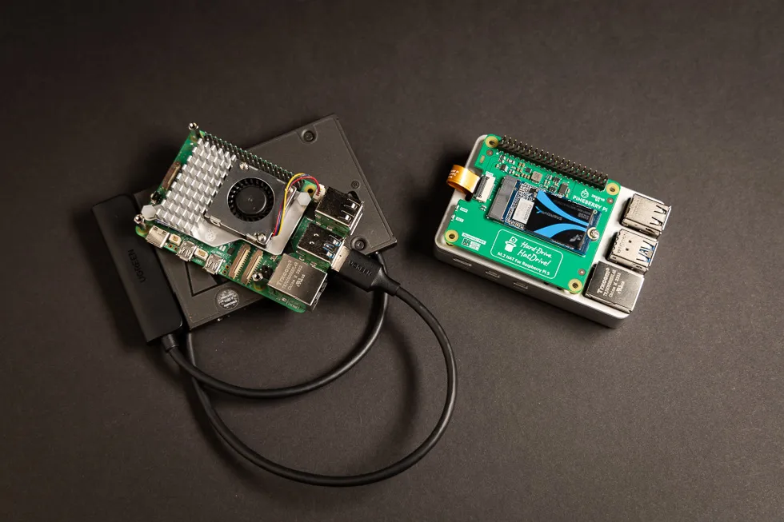
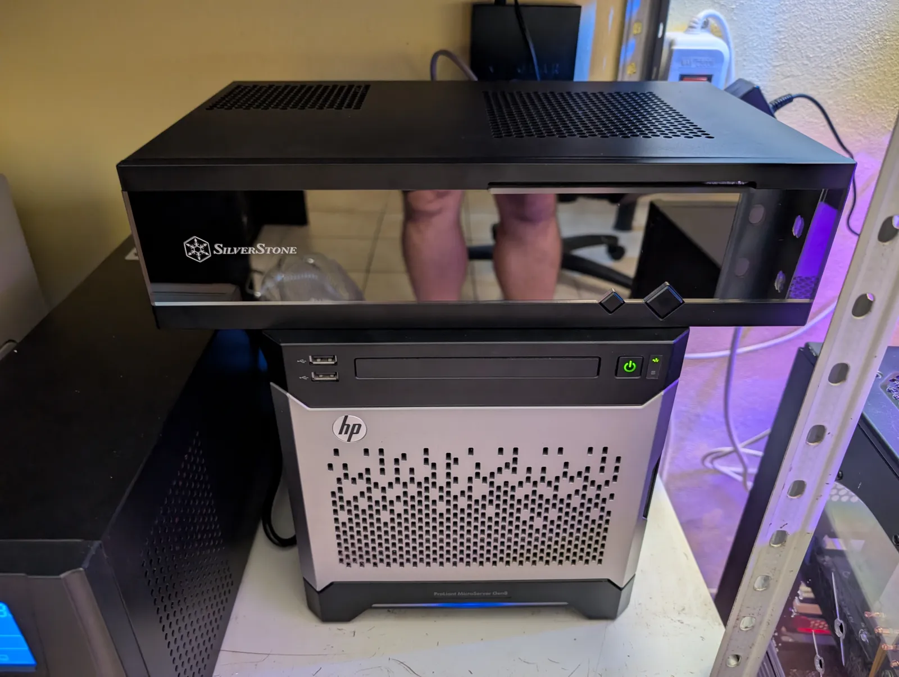

## Background

Some of the people who know me, particularly the nerdy ones, are aware that among my hobbies I have a rather expensive one called "homelabbing": running and managing various services for my digital life, from password managers to full replacements for Google services.

I started homelabbing back in 2017.
At the time, I was volunteering at my local [AVIS](#avis-side-note) branch as a general technician, and one of my first tasks was to build a PC for the office and digitize most of the documents that were still on paper.
After assembling the computer, I was left with a 3.5" 1TB Western Digital Blue that I had just replaced with a modern SSD, so I thought: "It would be a pity to throw this away. It's slow, but it's high capacity and it still works. I'll keep it!"
That's when I had an idea: why not attach this disk to a low-power device like a Raspberry Pi and use it as a NAS?
So I ordered a Raspberry Pi 3 and a USB enclosure for the 3.5" drive. Setting it up was super easy, as there are ready-made distros for the Raspberry Pi, such as DietPi, which simplify installing and configuring various services. Another big advantage was that everyone at home already used Linux, so setting up a network share was rather easy with technologies like NFS.

  
Side note for my foreign readers

  AVIS is an Italian blood donation association.
  In Italy, the blood supply for hospitals comes from voluntary donations, and there are various associations that promote donating by organizing social events throughout the year.
  During my travels abroad, I discovered that blood donation exists in other countries too, so I'd suggest checking it out!
  Not only do you normally get some perks, like a paid day off or free health checks, but you could potentially save a life every time you donate!

After a while, I said to myself: "The Pi sits idle 95% of the time, why not use it for something else too?", and that's when things started to get more interesting. I started digging into the [homelab subreddit](https://www.reddit.com/r/homelab/) and discovered a whole new world of self-hosted services.
I experimented with [Pi-hole](https://pi-hole.net/), a network-wide ad-blocking solution (which, by the way, works beautifully if you want to stop fucking ads from showing up on devices like the smart TV), and various other services for movies, files, etc. I don't have an original picture, but it looked very janky, something like this:

<figure class="post-figure">
  
  <figcaption>Source: <a href="https://dphacks.com/2023/12/24/pineberry-pis-pi-5-pcie-ssd-adapters/" target="_blank" rel="noopener">dphacks.com</a></figcaption>
</figure>

As I went deeper down the homelab rabbit hole, I bought a mini-ITX PC to build a proper firewall based on pfSense.
I learned how to properly set up NAT, VLANs, traffic shaping and so on. It was a really cool time, and I enjoyed learning system administration through a hands-on approach, especially since I was still at university, where professors taught almost exclusively theory and I felt like I was learning nothing really useful.
It also happened just before COVID, so with six of us sharing a 30 Mbit/s connection, traffic shaping really helped during the lockdown.

During this time, though, I realized that a Raspberry Pi was not enough. I was getting tired of not being able to copy files at gigabit speeds (the Pi 3 lacked a real Gigabit Ethernet port), and I also had some reliability issues with a few Docker containers.
I needed something more powerful, and possibly more reliable, so after some searching I found a very good deal on eBay: a second-hand HP MicroServer Gen8. On paper it looked perfect: it came already upgraded with 16GB of DDR3 ECC RAM and an Intel Xeon E3-1220L v2, and it had 4 bays for 3.5" hard drives.

That's when my homelab became a proper setup: I installed Ubuntu Server and I started experimenting with RAID 10 and later ZFS. I also began hosting more services, including a self-made Telegram bot for internal use in my family.

## Fast forward to today

After so many years, the Gen8 server is still rocking! I'm sorry to disappoint any reader who was expecting a new shiny rack.
The server is quiet, it draws a relatively low amount of power, and those four bays still hold the ZFS pool with all my data: photos, documents, music and everything else.

### From clicking around to Git

For a long time I managed everything through Portainer. It's a great tool to start with: you paste a compose file into a web UI, click deploy, and you're done. The problem shows up months later, when you no longer remember which version of which file is running, or why a container has that weird environment variable, or whichever toomfoolery you do with the configuration.
Another issue I was frequently having with Portainer was the constant need of recreation of some Dockers when I needed to just edit some variables (and I was never able to properly do it without the re-creation of the container...).

Anyway this year I decided to move everything into a single Git repository. Each group of services is a "stack" in its own folder:

| Stack | What's inside |
|---|---|
| `files` | [Nextcloud](https://nextcloud.com/) + [Collabora](https://www.collaboraonline.com/) (my Google Drive/Docs replacement), [Mealie](https://mealie.io/) for recipes |
| `media` | [Immich](https://immich.app/) (Google Photos replacement), [Navidrome](https://www.navidrome.org/) for music, plus Lidarr and some AI-based playlist generation with AudioMuse |
| `secure` | [Vaultwarden](https://github.com/dani-garcia/vaultwarden), a self-hosted Bitwarden-compatible password manager |
| `fmd` | [FMD Server](https://gitlab.com/fmd-foss/fmd-server), a "Find My Device" that doesn't report to Google |
| `proxy` | [Caddy](https://caddyserver.com/) as reverse proxy and [CoreDNS](https://coredns.io/) |

A small `deploy.sh` script finds the stacks, merges the committed defaults with the secrets that live only on the server, and brings everything up. It also has a `verify` command that checks every service is actually reachable, not just "running" according to Docker.

The best part is that a self-hosted GitHub Actions runner sits on the server, so **every time I push to the repo, the homelab redeploys itself.** (yeah I love CI/CD). The runner only makes outbound connections to GitHub, so I didn't need to open SSH to the world or hand out keys. Want to add a service? Create a folder, write a compose file, `git push`, pray, and (usually) done.

### Networking: invisible by default

The firewall side has evolved too. The pfSense box became an [OPNsense](https://opnsense.org/) box after the pfSense licensing drama (though it seems that Netgate recently changed their minds, [merging CE and Plus back into a single, free edition](https://www.netgate.com/blog/pfsense-at-20)).

One issue I had is that I had to connect to my own OpenVPN instance every time I wanted to use my services from outside, which is honestly a bit unconvenient. Luckily, there's a solution that addresses exactly this and it's called [Tailscale](https://tailscale.com/). In my setup, every service binds only to `127.0.0.1`, and Caddy is the only way in. Caddy itself listens only on the server's Tailscale address, so from the LAN or the internet there's simply nothing there.

I wanted nice names instead of `server:8081`, so I came up with a setup I'm rather proud of:

- Every service gets a name like `photos.lab.mydomain`.
- Tailscale's [split DNS](https://tailscale.com/kb/1054/dns) sends any query for `lab.mydomain` to a CoreDNS instance on the server, which answers with the server's Tailscale IP. Public DNS knows nothing about these names.
- For HTTPS, Caddy gets a real Let's Encrypt **wildcard certificate** through a [DNS-01 challenge](https://letsencrypt.org/docs/challenge-types/#dns-01-challenge). My domain registrar has no API, so I used a little trick: I pointed `_acme-challenge.lab` with a CNAME to a [DuckDNS](https://www.duckdns.org/) domain, which does have an API, and Caddy writes the challenge there.

The result: green padlocks everywhere, no browser warnings, and zero public footprint. Adding a new service is one line in the Caddyfile. CoreDNS answers for any name in the zone, so there's no DNS change. And I think this is cool!

### Backups, because RAID is not a backup

Of course, given that I already lost some data during these years, I also created some automatic backup system. In the server, the pool is made of two mirrored pairs, 2×2TB and 2×4TB, so it's basically the ZFS version of the RAID 10 I was playing with years ago. A monthly scrub checks every block against its checksum. That protects me from a dead disk, not from my own stupidity, so there are a few more layers on top:

- **Snapshots.** [Sanoid](https://github.com/jimsalterjrs/sanoid) takes automatic ZFS snapshots of the pool and keeps 12 hourly, 14 daily and 3 monthly ones. If I delete the wrong folder or an update corrupts a database, I can roll back in seconds.
- **The password vault.** It's the most critical piece, so it gets its own backup every night at 2 AM. The archive and its checksum are kept locally for two weeks and also uploaded off-site to Dropbox with [rclone](https://rclone.org/).
- **The little brother.** The small box on top of the Gen8 in the photo below is a dedicated backup server. It's powered off most of the time. Every few days the Gen8 wakes it up with Wake-on-LAN, waits for it to come online, and tells it to run a [restic](https://restic.net/) backup of the Nextcloud files and the Immich photo library. Once restic has finished and verified the repository, the Gen8 shuts it down again. A machine that is off can't be hit by ransomware or by an accidental `rm -rf`. And if a run fails, the job simply tries again the next night.

<figure class="post-figure">
  
  <figcaption>My HP MicroServer Gen8 and its little brother on top, which handles the restic backups.</figcaption>
</figure>

So to wrap this up, it all started with a spare 1TB hard drive I didn't want to throw away. Eight years later, that "I'll keep it!" turned into a hobby that runs half of my family's digital life. Not bad for a disk that was supposed to end up in the trash.